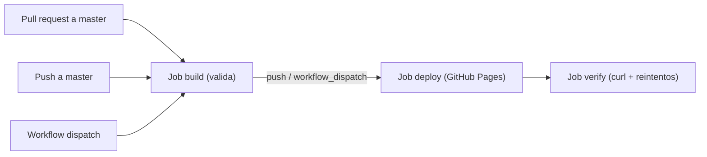

# Clean Architecture en Angular · UCEVA

Aplicación Angular del taller de **Arquitectura de Software** (UCEVA). Implementa un cliente con **arquitectura limpia**: el dominio define modelos y contratos de repositorio, la capa de aplicación expone casos de uso y la infraestructura ofrece tres implementaciones intercambiables de esos contratos (datos locales, backend NodeJS y backend SpringBoot). La capa de presentación consume solo casos de uso.

La aplicación muestra cinco listados —**usuarios, productos, cursos, pedidos y libros**— navegables desde un navbar, con estados de carga, éxito y error.

**Aplicación desplegada:** <https://ingdavidmora2005.github.io/Uceva-Angular-Taller-Clean-Architecture/>


## Demo y datos

El demo publicado **no depende de ningún backend**: `src/app/app.config.ts` registra las implementaciones locales de los cinco repositorios, que generan los datos en el navegador con [Faker](https://fakerjs.dev/). Los providers de NodeJS y SpringBoot están en el mismo archivo, comentados.

Por eso, las URLs `http://localhost:3000` y `http://localhost:8080` que aparecen en `src/environments/environment.ts` (y en la guía del taller al final) **solo aplican en desarrollo**, cuando se habilitan esas implementaciones. En GitHub Pages no hay backend y no se realizan peticiones HTTP.

## Stack

Versiones tomadas de `package.json`:

| Dependencia | Versión |
|---|---|
| Angular (`core`, `common`, `compiler`, `forms`, `platform-browser`, `router`) | 20.3.14 |
| Angular CLI / `@angular/build` | 20.3.12 |
| TypeScript | 5.9.2 |
| RxJS | 7.8.0 |
| zone.js | 0.15.0 |
| Bootstrap / Bootstrap Icons | 5.3.8 / 1.13.1 |
| `@brejcha13320/design-system-bootstrap` | 1.0.2 |
| Jest / `jest-preset-angular` / `ts-jest` | 30.2.0 / 15.0.3 / 29.4.5 |
| `@faker-js/faker` (dev) | 10.1.0 |

`@angular/cli` 20.3.12 declara `node: ^20.19.0 || ^22.12.0 || >=24.0.0`; el pipeline usa **Node 24**. El proyecto no fija `engines` en `package.json`.

Faker se importa de forma diferida (`import('@faker-js/faker/locale/en')` en `data.service.ts`) para que quede en un chunk aparte y el bundle inicial respete el presupuesto de `angular.json`: **708.51 kB** iniciales (141 kB comprimidos) y **485.83 kB** en el chunk diferido (128 kB comprimidos). El build emite un *warning* porque el CSS de Bootstrap supera los 500 kB de aviso, pero queda por debajo del máximo de error de 1 MB.

## Scripts

Los scripts reales de `package.json`:

```bash
npm ci                 # instalación reproducible
npm start              # ng serve en http://localhost:4200
npm run build          # ng build (producción por defecto)
npm test               # jest, una sola ejecución
npm run test:watch     # jest --watch
npm run test:coverage  # jest --coverage
npm run compodoc       # documentación con Compodoc
```

## Estructura

```
src/app
├── core
│   ├── domain          modelos y contratos de repositorio
│   ├── application     casos de uso (get-all-*)
│   └── infrastructure  data.service y repositorios
│       └── repositories
│           ├── local-implementation       datos con Faker
│           ├── node-implementation        HTTP al backend NodeJS
│           └── springboot-implementation  HTTP al backend SpringBoot
├── mocks               datos de ejemplo usados en pruebas
└── presentation
    ├── pages           users, products, courses, orders, books
    └── components      tablas y alertas
```

## Enrutamiento

- Rutas limpias con `PathLocationStrategy` (Angular Router por defecto; **no** se usa `useHash`).
- Rutas reales definidas en `src/app/app.routes.ts`: `/users`, `/products`, `/courses`, `/orders` y `/books`; la ruta comodín `**` redirige a `/users`.
- El build se genera con `--base-href /Uceva-Angular-Taller-Clean-Architecture/`.
- En el pipeline se copia `index.html` a `404.html` dentro de `dist/Angular-Standalone-Template/browser/`. GitHub Pages es un servidor estático y, sin ese truco, recargar una ruta profunda devolvería la página 404 genérica.
- **Limitación conocida:** Pages puede responder **HTTP 404** en rutas profundas aunque el navegador renderice la aplicación. Por eso el job de verificación exige el marcador `<app-root` en la respuesta, sin exigir estado 200 en esas rutas.

## CI/CD

Workflow [`deploy.yml`](.github/workflows/deploy.yml), nombre **CI/CD**. Se dispara con `push` y `pull_request` sobre `master` (rama por defecto del repositorio) y con `workflow_dispatch`.



- **build**: checkout, setup-node (Node 24, caché npm), `npm ci`, `npm test -- --ci`, build con el `base-href`, copia a `404.html` y validación de artefactos. En `pull_request` solo se ejecutan estas validaciones; `configure-pages` y `upload-pages-artifact` se omiten.
- **deploy**: depende de `build`; solo en `push` o `workflow_dispatch` sobre `master`; permisos `pages: write` e `id-token: write`; entorno `github-pages`; concurrencia `pages` sin cancelación; `actions/deploy-pages`.
- **verify**: depende de `deploy`; consulta la URL base **con barra final** (sin ella Pages responde 301), exige HTTP 200 y `<app-root`, comprueba que el bundle principal responde 200 y pide `/users` aceptando 404 con `<app-root` en el cuerpo (efecto del `404.html`). Deja un resumen en el *step summary*.

Versiones de las actions verificadas contra sus releases oficiales: `checkout@v7`, `setup-node@v7`, `configure-pages@v6`, `upload-pages-artifact@v5` y `deploy-pages@v5`.

## Pruebas

```bash
npm test
```

**132 pruebas en 33 suites**, todas en verde con Jest 30 y `jest-preset-angular`, con cobertura del 100 % en los archivos medidos. Cubren casos de uso, repositorios locales, de NodeJS y de SpringBoot, `data.service`, tablas, alertas, páginas y el componente raíz.

## Despliegue

Un único paso manual en GitHub: **Settings → Pages → Source = GitHub Actions**. Después, cada push a `master` publica la aplicación y el job `verify` comprueba que responde.

## Autoría

Taller de la materia **Arquitectura de Software** de la **UCEVA**, desarrollado en equipo. Este repositorio es un fork de [Brejcha13320/Uceva-Angular-Taller-Clean-Architecture](https://github.com/Brejcha13320/Uceva-Angular-Taller-Clean-Architecture); el historial local no permite confirmar el rol de esa cuenta, así que se cita como repositorio base.

Contribuyentes según `git shortlog -sn`:

- David Mora Duque
- Juan Diego Rodriguez
- Juan Pablo Devia
- Jesus David Mejia Vergara

---

# Guía del taller

Contenido original de la guía paso a paso del taller. Los nombres de las carpetas de implementaciones cambiaron con el tiempo: hoy son `local-implementation`, `node-implementation` y `springboot-implementation`.

```
src/app
│
├── core
│   ├── domain
│   │   ├── models
│   │   │   ├── user.model.ts
│   │   │   └── product.model.ts
│   │   └── repositories
│   │       ├── user.repository.ts
│   │       └── product.repository.ts
│   │
│   ├── application
│   │   └── use-cases
│   │       ├── get-all-users.usecase.ts
│   │       ├── get-user-by-id.usecase.ts
│   │       ├── get-all-products.usecase.ts
│   │       └── get-product-by-id.usecase.ts
│   │
│   └── infrastructure
│       ├── services
│       │   ├── user-api.service.ts
│       │   └── product-api.service.ts
│       └── repositories
│           ├── user.repository.impl.ts
│           └── product.repository.impl.ts
│
├── presentation
│   ├── users
│   └── products
│
└── app.config.ts
```

## Paso 1 - Crear Modelos

```
src/app/core/domain/models/
├── user.model.ts
└── product.model.ts
```

## Paso 2 - Crear Repositorios

```
src/app/core/domain/repositories/
├── user.repository.ts
└── product.repository.ts
```

## Paso 3 - Crear Casos de Uso

### User

```
src/app/core/application/usecases/user/
├── get-all-users.usecase.ts
└── get-user-by-id.usecase.ts
```

### Product

```
src/app/core/application/usecases/product/
├── get-all-products.usecase.ts
└── get-product-by-id.usecase.ts
```

## Paso 4 - Crear Servicios

```
src/app/core/infrastructure/services/
├── user.service.ts
└── product.service.ts
```

## Paso 5 - Crear Repositorios Implementadores

### Implementación para Consumo de Datos Local

```
src/app/core/infrastructure/repositories/local
├── user-local.repository.impl.ts
└── product-local.repository.impl.ts
```

### Implementación para Consumo de Datos NodeJS

```
src/app/core/infrastructure/repositories/node
├── user-node.repository.impl.ts
└── product-node.repository.impl.ts
```

## Paso 6 - Agregar Providers con sus Implementadores

```
src/app/
└── app.config.ts
```

# Funcionamiento del Frontend

## Ejecutar Frontend

```
npm run start
```

## Urls Consumo

### Frontend

```
http://localhost:4200
```

### Backend NodeJS

```
http://localhost:3000/api/docs
http://localhost:3000/api/users/{countUsers}
http://localhost:3000/api/products/{countProducts}
```

### Backend SpringBoot

```
http://localhost:3000/api/swagger-ui/index.html
http://localhost:3000/api/users/{countUsers}
http://localhost:3000/api/products/{countProducts}
```
